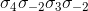
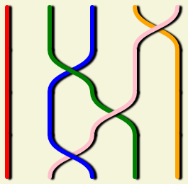
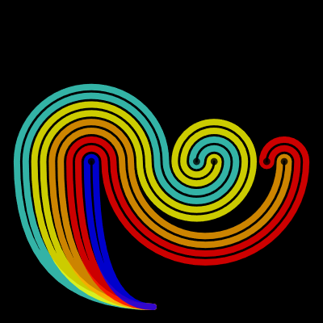

# Ardoise à tresse

Un notebook pour dessiner des éléments du groupe de tresse (Artin braid group).

Exemple du dessin de la tresse  avec l'appel `dessine_tresse([4, -2, 3, -2])`:



Accéder au notebook : [](https://mybinder.org/v2/gh/xysticus/braid-blackboard/master?filepath=ipynbks/CanvasTresseOmbre.ipynb)

Et maintenant la représentation d'Artin avec un exemple.



Accéder au notebook : [](https://mybinder.org/v2/gh/xysticus/braid-blackboard/master?filepath=ipynbks/CanvasAutoMorph.ipynb)

C'est [ipycanvas](https://github.com/martinRenou/ipycanvas) qui est utilisé pour dessiner sur le canvas [HTML5](https://fr.wikipedia.org/wiki/Canvas_(HTML)).

## Le film des méandres

Au lieu d'une image figée pour une tresse donnée, `programmes/Triangulation.py` fabrique un film : à chaque lettre
σ_i, les trous i et i+1 tournent d'un demi-tour l'un autour de l'autre et entraînent continûment les lacets, qui
dessinent au fil du film l'automorphisme du groupe libre associé à la tresse.

```
python programmes/Triangulation.py   # depuis la racine du dépôt : écrit imgs/film_triangule_*.mp4
```

Le principe :

- le disque est découpé en triangles dont les sommets sont les trous, le clou et des points des bords ;
- un lacet est une suite de points posés sur les arêtes ; quand les trous bougent, les triangles se déforment et les
  points suivent leurs arêtes ; quand un triangle devient trop plat, on change de triangulation (retournement
  d'arête, critère de Delaunay) sans changer la forme des lacets ;
- les lacets sont tendus comme des élastiques : ils s'enroulent en arcs de cercle autour des trous et vont en ligne
  droite d'un enroulement à l'autre ;
- les mots du groupe libre relus sur chaque image sont vérifiés contre le calcul algébrique.

### Parenté avec le morphing

Ce film rappelle le **morphing** (ou morphose), ces images qui se transforment progressivement en d'autres, rendues
célèbres au début des années 1990 (le clip *Black or White* de Michael Jackson, des génériques de télévision).
Le morphing combine deux opérations :

1. une **déformation géométrique** (*warping*) : des points de correspondance sont placés sur les deux images et l'on
   déforme continûment la première pour amener ses points sur ceux de la seconde ;
2. un **fondu enchaîné** : pendant la déformation, les couleurs des deux images se mélangent progressivement.

Une méthode classique de déformation consiste justement à trianguler les points de correspondance (souvent par
Delaunay) et à déformer chaque triangle par une application affine pendant que ses sommets se déplacent : c'est
exactement ce que fait notre triangulation mobile, dont les sommets sont les trous.

La différence est que le film ne fait que la première opération, sans fondu : les lacets sont transportés par une
déformation continue du plan (une isotopie), et c'est ce qui garde leur topologie exacte. Les premiers essais, qui
mélangeaient linéairement deux dessins (une sorte de fondu), créaient des croisements entre lacets.

Mon livre de chevet sur les tresses : "[Le calcul des tresses](https://www.decitre.fr/livres/le-calcul-des-tresses-9782916352794.html)", [Patrick Dehornoy](https://www.decitre.fr/auteur/198862/Patrick+Dehornoy), Calvage & Mounet, Collection.-Nano
