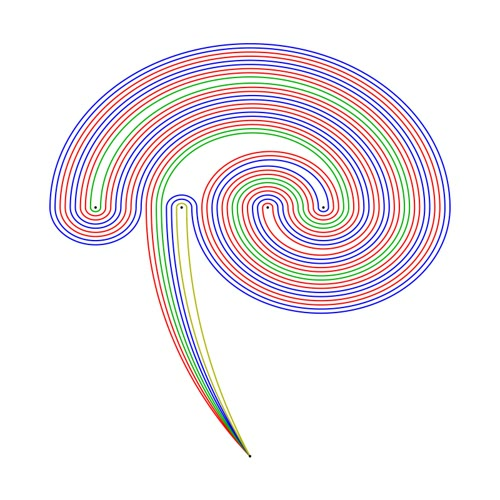
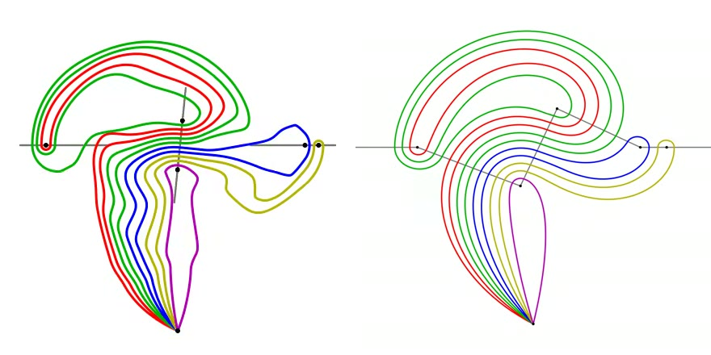

# Le film conforme

<p align="center"></p>

Les lacets du groupe libre, dessinés comme dans les images fixes du projet : des arcs posés perpendiculairement sur
l'axe, qui partent du clou et y reviennent. Le film les fait vivre pendant que les trous tournent.

## Fabriquer les films

Depuis la racine du dépôt :

```
python python/Conforme.py
```

Écrit `film_43m1m12m41.mp4` (la tresse σ₄σ₃σ₁⁻¹σ₁⁻¹σ₂σ₄⁻¹σ₁) et `film_charge.mp4` (σ₁σ₂⁻¹σ₁σ₂⁻¹σ₁σ₂⁻¹σ₃σ₁⁻¹σ₂) dans ce
répertoire, en 800 × 800, et vérifie chaque image (environ 1 min 30). La réécriture OCaml (`ocaml/`, voir
`ocaml/explications.md`) écrit les mêmes films, identiques octet pour octet, en 40 s : depuis `ocaml/`,
`dune exec bin/conforme.exe` → `film_43m1m12m41_ocaml.mp4` et `film_charge_ocaml.mp4` (ffmpeg avec libsvtav1, celui de
l'environnement conda : `FFMPEG=…/envs/braid-blackboard/bin/ffmpeg`). Pour une autre tresse :

```
python -c "import sys; sys.path.insert(0, 'python'); import Conforme as C; C.film_conforme([1, 2, -1], 'imgs/conforme/f.mp4', hauteur=800, largeur=800, marge=60)"
```

## La méthode

Une tresse σ_i fait tourner les trous i et i+1 d'un demi-tour l'un autour de l'autre ; elle agit sur le groupe libre
F_n des lacets qui partent du clou (action d'Artin). Chaque image clé du film montre les images des générateurs
x_1 … x_n, dessinées en demi-cercles posés sur l'axe.

- **La ligne brisée.** Pendant le demi-tour des trous A et B, l'axe se plie : il va du trou voisin L à A, de A à B, de
  B au voisin R. Cette ligne L–A–B–R porte exactement les points de l'image clé de départ ; la ligne L–B–A–R porte
  ceux de l'image clé d'arrivée.
- **La représentation conforme.** Une transformation de Schwarz–Christoffel (qui conserve les angles) envoie le
  demi-plan sur la région au-dessus de la ligne brisée, et une autre sur la région au-dessous. On trace les lacets en
  demi-cercles dans le demi-plan, entre les antécédents de leurs pieds, et la transformation les emporte : ils arrivent
  perpendiculairement sur les segments, et deux arcs ne peuvent pas se croiser (la transformation est une bijection, et
  deux demi-cercles se croisent si et seulement si leurs extrémités s'entrelacent). Les demi-cercles sont les droites
  du demi-plan de Poincaré : les lacets sont tendus. Les descentes vers le clou sont, elles aussi, de ces géodésiques.
- **Le raccord.** À mi-chemin, quand les deux trous sont à la verticale l'un de l'autre, on passe du dessin de départ
  au dessin d'arrivée. Ce passage se fait sur une triangulation mobile dont les sommets sont les trous et le clou : les
  deux dessins y sont transportés par la déformation du plan (une isotopie), puis, autour des deux trous qui tournent,
  tendus en droites arrondies dont les pieds glissent sur les arêtes sans changer d'ordre.
- **La vérification.** Sur chaque image, les mots du groupe libre sont relus sur le dessin (traversées des demi-droites
  qui montent des trous) et comparés au calcul algébrique, et les croisements entre lacets sont comptés : aucune
  anomalie sur les deux tresses.

Code : `python/Conforme.py` (cartes de Schwarz–Christoffel, dessin), `python/Raccord.py` (le raccord). Les
pistes explorées et leurs résultats : `pistes_film_conforme.md`.

<p align="center"></p>

<p align="center"><em>Le même instant de la tresse σ₄σ₃σ₁⁻¹σ₁⁻¹σ₂σ₄⁻¹σ₁, au milieu du demi-tour de σ₂ : à gauche
l'ancien film simultané, où deux dessins sont mélangés pendant tout le demi-tour, à droite le film conforme.</em></p>
