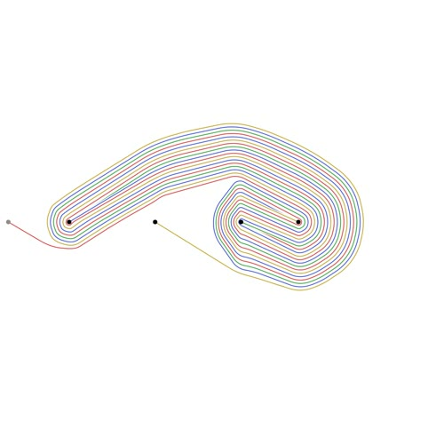

# Le diagramme de courbes

<p align="center"></p>

Au départ, l'image est l'axe lui-même, coupé en segments par les trous ; la tresse emporte ces segments, qui
s'enroulent autour des trous. Pas de clou, rien d'accroché en bas : seulement des arcs d'un trou à l'autre.

## Fabriquer les films

Depuis la racine du dépôt :

```
python programmes/Arcs.py diagramme
```

Écrit `film_43m1m12m41.mp4` et `film_charge.mp4` dans ce répertoire après avoir vérifié la tresse (moins d'une
demi-minute). Les films `film_geodesiques_*.mp4` sont la variante hyperbolique :

```
python -c "import sys; sys.path.insert(0, 'programmes'); import Arcs as A; A.film_arcs([4, 3, -1, -1, 2, -4, 1], 'imgs/diagramme/film_geodesiques_43m1m12m41.mp4', classe=A.DiagrammeCourbes, lisere=True, hyperbolique=True)"
```

## Les mathématiques

Le **diagramme de courbes** d'une tresse est l'image, par la tresse, des segments de l'axe : du point fixe (à gauche)
au premier trou, puis d'un trou au suivant. C'est un **invariant complet** : deux tresses sont égales si et seulement
si leurs diagrammes sont isotopes (déformables l'un en l'autre sans qu'un arc passe par un trou). En effet, l'axe
entier découpe le disque troué en un disque sans trou, et un homéomorphisme qui laisse l'axe en place à isotopie près
est isotope à l'identité (lemme d'Alexander). Il porte la même information que l'action d'Artin sur le groupe libre,
avec deux fois moins de traits que les lacets (qui font l'aller et le retour). C'est l'outil avec lequel Fenn,
Greene, Rolfsen, Rourke et Wiest, puis Dehornoy, comparent les tresses (de mémoire).

## La méthode

- **La triangulation mobile.** Les trous et le point fixe sont les sommets d'une triangulation de Delaunay. Un arc est
  la suite de ses pieds sur les arêtes, chacun posé à une fraction de son arête.
- **Le transport.** Quand les trous bougent, chaque pied suit son arête ; quand une arête cesse d'être de Delaunay, on
  la retourne, et les arcs sont recalculés dans les nouveaux triangles sans changer de forme. C'est une déformation
  continue du plan (une isotopie) : la topologie des arcs est garantie, aucun croisement n'est possible.
- **La tension.** Chaque pied est tiré vers l'alignement de ses voisins, en gardant un écart minimal entre brins et
  l'ordre sur chaque arête : les arcs sont tendus comme des élastiques. Le dessin est la ligne brisée des pieds, chaque
  coude arrondi par un arc de cercle. Chaque arc est tracé en blanc large avec un liseré de couleur fin au milieu.
- **Le mouvement.** Seuls les deux trous qui tournent font un demi-tour, à vitesse angulaire constante ; tous les trous
  glissent doucement vers un espacement proportionnel au nombre de brins de chaque intervalle (interpolation lisse et
  monotone à travers toutes les images clés).
- **La vérification.** Le premier arc (du point fixe au premier trou) est le lacet x_1 : le mot relu sur le bord d'un
  ruban autour de lui est comparé, après chaque lettre, à l'image algébrique de x_1.
- **La variante hyperbolique.** Chaque triangle de Delaunay, vu dans son cercle circonscrit, est un triangle idéal du
  modèle de Klein ; les arcs y sont tendus en géodésiques. Belle sur les tresses légères, illisible sur les tresses
  chargées : des géodésiques voisines se rapprochent exponentiellement et les brins se confondent.

Code : `programmes/Arcs.py` (`DiagrammeCourbes`), sur le moteur de `programmes/Triangulation.py` ;
`programmes/Geodesiques.py` pour la variante hyperbolique.
