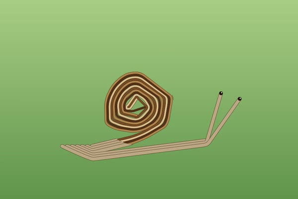

# L'escargot

<p align="center"></p>

Un escargot fait de sept rubans, qui sortent d'une flaque de demi-ellipses sous l'axe : la coquille s'enroule, la tête
avance, les antennes se dressent.

## Fabriquer le film

Depuis la racine du dépôt :

```
python python/Escargot.py
```

Écrit `film.mp4` dans ce répertoire (960 × 640, 14 s, quelques secondes de calcul). La version OCaml, depuis
`ocaml/` : `dune exec bin/escargot.exe` écrit `film_ocaml.mp4`, identique octet pour octet.

## La méthode

C'est la méthode des rubans, trous fixes à gauche (voir `imgs/rubans_gauche/README.md`), avec une chorégraphie libre
des trous voyageurs, comme le bouquet :

- les trous fixes, groupés au bout gauche de l'axe, sont la queue ; chaque arc va d'un trou fixe à un trou voyageur, et
  au départ ce sont des demi-ellipses emboîtées sous l'axe ;
- la coquille : quatre trous en anneau montent au-dessus du corps et tournent ensemble trois tours. Tourner un groupe de
  trous d'un tour complet, c'est un twist de Dehn : les arcs qui y aboutissent s'enroulent autour de l'anneau, et
  chaque tour ajoute une couche. D'où la spirale, quatre bandes par tour ;
- la tête : un trou qui va à l'avant, au sol. Il est avant les yeux sur l'axe, donc les arcs des yeux passent dessous ;
- les antennes : les deux yeux partent devant la tête puis montent ; leurs arcs, retenus sous la tête, s'en élèvent ;
- comme toujours, les arcs sont transportés par la triangulation mobile (une déformation continue du plan : jamais de
  croisement) et tendus.

Dessin : chaque arc en ruban plein cerné de brun sombre ; dans la coquille, bandes brun, beige et marron selon l'arc ;
ailleurs, couleur chair, plus épaisse, pour que les brins se fondent en un pied.

Code : `python/Escargot.py`.
