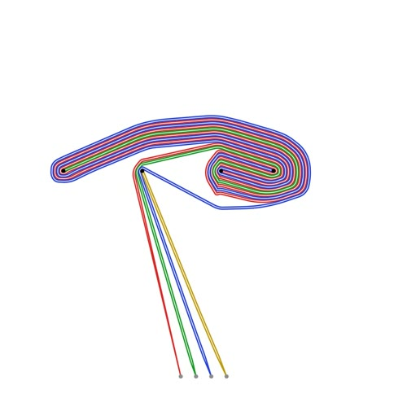

# Les rubans

<p align="center"></p>

Les lacets du groupe libre, mais sans clou : chaque lacet est le bord d'un ruban mince tendu entre un trou fixe, en bas,
et son trou voyageur. Le mouvement est très doux : un seul mouvement continu, une seule manière de dessiner.

## Fabriquer les films

Depuis la racine du dépôt :

```
python programmes/Arcs.py rubans
```

Écrit `film_43m1m12m41.mp4` et `film_charge.mp4` dans ce répertoire après avoir vérifié les mots (moins d'une
demi-minute). `film_arcs_43m1m12m41.mp4` montre les arcs seuls, `film_geodesiques_43m1m12m41.mp4` les arcs tendus en
géodésiques hyperboliques :

```
python -c "import sys; sys.path.insert(0, 'programmes'); import Arcs as A; A.film_arcs([4, 3, -1, -1, 2, -4, 1], 'imgs/rubans/film_arcs_43m1m12m41.mp4')"
python -c "import sys; sys.path.insert(0, 'programmes'); import Arcs as A; A.film_arcs([4, 3, -1, -1, 2, -4, 1], 'imgs/rubans/film_geodesiques_43m1m12m41.mp4', hyperbolique=True)"
```

## Les mathématiques

Une tresse agit sur le groupe libre F_n des lacets qui partent du clou (action d'Artin). Le lacet x_i, du clou autour
du trou i, est le bord d'un voisinage mince de l'**arc** qui va du clou au trou i : l'image de l'arc par la tresse
donne celle du lacet. On remplace le clou par n trous fixes f_1 … f_n, rangés là où il était, et chaque lacet par
l'arc de f_i au trou voyageur m_i. La tresse ne fait bouger que les trous voyageurs ; tant que les trous fixes restent
groupés là où ils ne sont jamais balayés, l'action sur ces arcs équivaut à l'action d'Artin. Plus ils sont serrés,
plus on se rapproche du clou ; en dessous de 30 pixels d'écart, des triangles trop minces dérèglent la tension.

## La méthode

- **La triangulation mobile.** Les trous voyageurs et les trous fixes sont les sommets d'une triangulation de
  Delaunay. Un arc est la suite de ses pieds sur les arêtes ; au départ, ce sont des segments du trou fixe au trou
  voyageur.
- **Le transport.** Quand les trous bougent, chaque pied suit son arête ; les arêtes qui cessent d'être de Delaunay
  sont retournées sans changer la forme des arcs. C'est une isotopie : aucun croisement n'est possible.
- **La tension.** Chaque pied est tiré vers l'alignement de ses voisins, avec un écart minimal entre brins : les arcs
  sont tendus. Dessin : ligne brisée des pieds, coudes arrondis ; le lacet est le bord d'un ruban autour de l'arc (deux
  rubans d'arcs disjoints sont disjoints).
- **Le mouvement.** Demi-tours à vitesse angulaire constante ; les trous voyageurs glissent doucement vers un
  espacement proportionnel au nombre de brins (interpolation lisse et monotone à travers toutes les images clés).
- **La vérification.** Après chaque lettre, les mots relus sur les rubans (traversées des demi-droites qui montent des
  trous voyageurs) sont comparés au calcul algébrique.

Code : `programmes/Arcs.py` (`FilmArcs`), sur le moteur de `programmes/Triangulation.py` ; variante hyperbolique dans
`programmes/Geodesiques.py`. Variante avec les trous fixes au bout de l'axe : `imgs/rubans_gauche/`.
