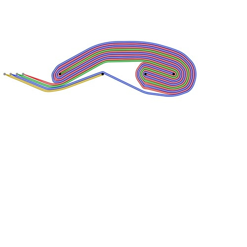

# Les rubans, trous fixes à gauche

<p align="center"></p>

La méthode des rubans (`imgs/rubans/`), mais avec les trous fixes groupés au bout gauche de l'axe au lieu d'une ligne
en bas : rien n'est accroché en bas, et chaque ruban part de l'axe.

## Fabriquer les films

Depuis la racine du dépôt :

```
python python/Arcs.py rubans_gauche
```

Écrit `film_43m1m12m41.mp4` et `film_charge.mp4` dans ce répertoire après avoir vérifié les mots (moins d'une
demi-minute).

## Les mathématiques

Comme pour les rubans : chaque lacet x_k est le bord d'un ruban autour de l'arc qui va d'un trou fixe f_k au trou
voyageur m_k, et l'action de la tresse sur ces arcs équivaut à l'action d'Artin sur le groupe libre, tant que les
trous fixes restent là où les demi-tours ne passent jamais. Sur l'axe, cela impose de les grouper à un bout : un trou
fixe placé entre deux trous voyageurs serait dans le disque de leur demi-tour, et l'on calculerait une autre tresse.

Les trous fixes sont rangés à l'envers : f_n le plus à gauche, f_1 le plus près du premier trou voyageur. L'arc de f_k
à m_k passe sous m_1 … m_(k-1), comme le lacet x_k depuis le clou, qui était sous l'axe : au départ, les arcs sont des
demi-ellipses emboîtées sous l'axe (leurs intervalles [f_k, m_k] sont emboîtés, donc elles ne se croisent pas).

## La méthode

Triangulation mobile, transport par isotopie, tension, rubans, glissement doux de l'espacement et vérification des
mots : exactement comme pour les rubans (voir `imgs/rubans/README.md`).

Code : `python/Arcs.py` (`FilmArcs(..., fixes='gauche')`).
